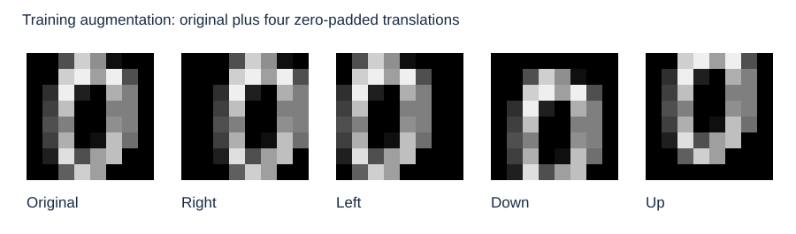
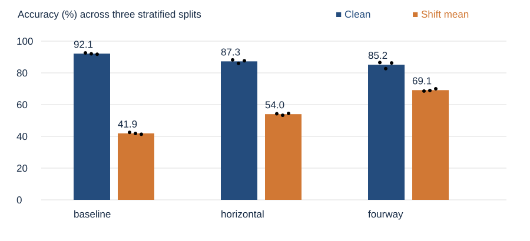
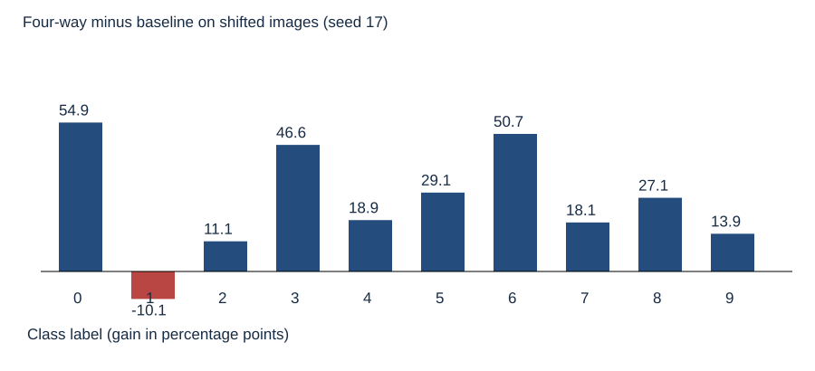

# 基于平移数据增强的手写数字岭回归分类器鲁棒性研究

作者：待填写

单位：待填写

## 摘要

针对低分辨率手写数字分类器容易受图像位置变化影响的问题，本文在公开 Digits 数据集上，复现岭回归分类与确定性平移数据增强的基本思想，研究低成本增强所带来的鲁棒性收益及原图性能代价。本文构造仅使用原图的基线、加入水平平移的消融方法以及加入上下左右平移的完整方法。三个分层随机划分均包含 1074 个训练样本、359 个验证样本和 364 个测试样本。所有增强均在划分后进行，正则化参数仅依据验证集确定。真实运行结果表明，四方向增强的平移平均准确率达到 69.14%，相较基线提高 27.24 个百分点；同时，原图准确率由 92.12% 下降至 85.16%。水平增强的消融结果进一步表明，训练时覆盖扰动方向能够改善对应测试表现。本文的贡献是可复现的受控实验和收益边界分析，而非提出新的学习算法。实验说明，在有限表达能力的线性模型中，增强能够改善已知位移下的稳定性，但不能保证原始分布性能同步提高。

关键词：计算机视觉；手写数字识别；数据增强；岭回归；平移鲁棒性

## Translation Augmentation for Robust Ridge Classification of Handwritten Digits

Author: To be completed

Affiliation: To be completed

### Abstract

This study evaluates deterministic translation augmentation for handwritten digit recognition using a ridge classifier on the public Digits dataset. A clean-image baseline, a horizontal augmentation ablation, and a four-direction augmentation method are compared across three stratified random splits. Each split contains 1,074 training, 359 validation, and 364 test examples. Augmentation is applied after splitting, and regularization is selected exclusively on validation data. Actual experiments show that four-direction augmentation achieves a mean translated-image accuracy of 69.14%, improving over the baseline by 27.24 percentage points. However, clean-image accuracy decreases from 92.12% to 85.16%. The horizontal-only ablation supports the importance of matching training transformations to evaluation directions. This work provides a reproducible controlled study of a classical approach rather than a novel learning algorithm. The findings demonstrate a trade-off between robustness to specified translations and performance on the original distribution within a limited-capacity linear hypothesis class.

Keywords: computer vision; handwritten digit recognition; data augmentation; ridge regression; translation robustness

## 1 引言

手写数字识别是计算机视觉的经典任务。在真实采集过程中，字符的中心位置会受书写、分割与裁剪过程影响。即使语义类别不变，像素位置改变仍可能显著影响依赖固定坐标的分类器。因而，在报告原图准确率以外，检验小幅位置变化下的性能，有助于揭示模型是否依赖样本的固定对齐方式。

卷积网络利用局部连接与共享权重处理图像结构，并已在文档识别任务中取得重要进展[1]。但若直接采用复杂模型，性能变化可能同时来自模型容量、优化策略和增强过程，难以辨别单一因素。本文采用具有闭式解的线性岭回归模型[2]，将模型容量和优化方式保持一致，以较低计算成本检验平移增强的作用。

本文提出以下待检验假设：其一，训练阶段引入上下左右一像素平移，可以提高相同扰动下的分类准确率；其二，只引入水平位移时，收益主要集中在水平方向；其三，在线性模型容量固定时，面向扰动分布的训练可能牺牲原图性能。第三项是需要报告的潜在代价，而非预设增强必然优越。

本文工作包括建立数据划分后再增强的实验流程，提供方向消融与多随机划分对照，保存全部模型权重、划分索引和逐样本预测，并结合负向结果分析适用边界。这里的“提出方法”指本文实施和检验的四方向增强方案，不主张该方案具有算法首创性，也不声称完整复现某一篇历史论文的全部设置。

## 2 相关工作

### 2.1 手写数字与图像分类

LeCun 等在文档识别研究中系统展示了基于梯度学习的识别方法与卷积结构[1]。本文不复现其网络结构，而选择低分辨率数字作为受控研究对象。所用 Digits 来自 scikit-learn 随附的公开数据，共 1797 个样本、10 个类别，每张图像为 8×8 灰度图，像素取值为 0 至 16[3–4]。该数据与通常使用的 28×28 MNIST 不同，本文所有结论均限定于 Digits。

### 2.2 正则化线性学习

岭回归通过二次惩罚缓解共线性与估计不稳定性[2]。将分类标签编码为独热向量后，可以使用多输出回归拟合类别响应，并取最大响应对应的类别。该方法不具有卷积共享权重或显式平移不变性，因而适合观察增强是否能够仅通过训练分布改变提升扰动表现。它的输出是判别分数，不应解释为校准概率。

### 2.3 数据增强与分布覆盖

数据增强通过几何变换、外观变换等方式扩展训练样本的变化范围。Shorten 和 Khoshgoftaar 对图像增强方法进行了综述[5]。增强的有效性依赖变换是否合理、标签是否能够保留，以及训练变换与实际部署扰动是否匹配。本文仅考察零填充的一像素平移，不将已知变换上的提升解释为对任意分布偏移的鲁棒性。

## 3 方法

### 3.1 数据表示与预测规则

设原始图像展平后为 x∈R⁶⁴。本文先按固定上界 16 进行归一化，再增加常数项得到 z=[x/16,1]∈R⁶⁵。归一化不估计整体数据统计量，因而不会因使用测试均值或方差产生信息泄漏。标签 y∈{0,…,9} 被编码为十维独热向量 t。

给定 N 个训练样本，记设计矩阵为 Z，目标矩阵为 T。模型学习参数 W∈R⁶⁵×¹⁰，优化目标为

L(W) = ‖ZW−T‖²_F / N + λ‖DW‖²_F。 （1）

其中 D=diag(1,…,1,0)，常数项不参与正则化。采用按样本数平均的损失，可避免增强样本数量变化直接改变正则项与数据项的相对标度。闭式解为

W = (ZᵀZ/N + λDᵀD)⁻¹ ZᵀT/N。 （2）

实际实现使用 numpy.linalg.solve 求解线性方程，不显式计算逆矩阵。预测规则为 ŷ=argmaxₖ(zW)ₖ。三个方法均包含 650 个浮点参数，推理结构一致，不包含测试时增强或模型集成。

### 3.2 零填充平移增强

定义平移算子 S_(dy,dx)。将图像沿给定方向移动一像素，空缺区域置零，超出边界的像素丢弃。本文不使用循环平移，以避免图像边缘像素从另一侧回卷。像素平移量 1 相当于图像边长的 12.5%，对 8×8 图像并非可以忽略的小变化。

原图基线仅使用原始训练集。水平增强使用原图、左移及右移三个视图；四方向增强使用原图、左移、右移、上移及下移五个视图。每个视图具有相同训练权重，继承原图标签。对应训练规模为 1074、3222 和 5370。原始图像可能包含靠近边缘的笔画，因此标签不变假设在裁剪严重时未必完全成立，这是本方案的重要局限。

图1 训练增强示例。图中原图及四个变换来自同一实际样本；空缺位置为黑色零像素。

### 3.3 参数选择与实验流程

正则化系数候选集合为 {0.0001,0.001,0.01,0.1,1}。每种方法独立选择验证集得分最高的系数，验证得分为原图、右移、左移、下移、上移五组准确率的等权平均。若出现并列，则保留候选顺序中最先出现的值。基线也使用相同验证目标，避免增强方法独占扰动验证信息。该设置意味着本文研究已知位移场景，不能解释为完全未知扰动泛化。

实验流程为：先按原始样本索引分层划分；只增强训练部分；在验证部分生成固定评估变换并调参；选定系数后直接评估测试集；保存权重与预测。选定模型不再合并验证集重训，因此测试模型对应的训练样本数与上述设置一致。

## 4 实验设计

### 4.1 数据与划分

本文使用 scikit-learn 分发包内的 digits.csv.gz 原始数据文件，训练过程仅依赖 NumPy，不调用 scikit-learn 训练器。对每个类别独立随机打乱，前 floor(0.6nₖ) 个进入训练集，接着直到 floor(0.8nₖ) 的样本进入验证集，其余进入测试集。随机数生成器为 numpy.random.default_rng，随机种子分别为 17、29 和 43。三个划分相互独立，但彼此可能共享样本，不能视作三个独立采集的数据集。

|项目|设置|
|---|---|
|数据规模|1797 张 8×8 灰度图，10 类|
|单次划分|训练 1074，验证 359，测试 364|
|训练模型|多输出岭回归，650 个参数|
|增强视图|基线 1 个，水平 3 个，四方向 5 个|
|调参|每方法 5 个 λ；验证五视图平均准确率|
|运行环境|Python 3.13.12，NumPy 2.5.4，Windows 11，CPU|

表1 实验配置。按类别取整使总体比例略偏离精确的 60∶20∶20。未采集完整 CPU 型号，不报告硬件性能比较。

### 4.2 指标和统计口径

原图准确率为正确分类样本数占测试样本数的比例；平移平均准确率为四个方向准确率的算术平均。每次划分的四方向评估共包含 1456 个变换视图，但只有 364 个独立来源图像，不能把这些视图当作 1456 个独立样本进行显著性检验。Macro-F1 为十个类别 F1 的等权平均。主表报告三个划分的均值与样本标准差，标准差使用分母 3−1。

本文不使用测试集挑选最优种子，也不合并三次测试结果宣称独立大样本结论。跨划分差异主要反映划分敏感性，不等价于总体置信区间。训练计时在原始日志中保留，但闭式解任务过小、计时波动较大，本文不以其证明效率提升。

## 5 实验结果与讨论

### 5.1 总体比较

|方法|原图准确率 %|平移平均准确率 %|原图 Macro-F1 %|
|---|---:|---:|---:|
|原图基线|92.12 ± 0.42|41.90 ± 0.59|91.98 ± 0.47|
|水平增强|87.27 ± 1.14|54.01 ± 0.62|86.69 ± 1.09|
|四方向增强|85.16 ± 2.15|69.14 ± 0.75|84.48 ± 2.30|

表2 三个随机划分上的均值 ± 样本标准差。平移平均指标仅包含四个扰动视图，不包含原图。

图2 总体结果。柱形为三次划分的均值，黑点为各次划分结果。图中英文标签分别对应原图基线、水平增强和四方向增强。

四方向增强将平移平均准确率提高 27.24 个百分点，三个划分的提升分别为 26.03、27.06 和 28.64 个百分点，方向一致。该结果支持引言中的第一项假设：在训练中覆盖目标位移，能够改善对应扰动下的表现。

与此同时，原图准确率平均变化为 -6.96 个百分点，三个划分均出现下降。其原因可能是固定容量的线性分类器需要以同一组系数同时拟合多种空间布局，原本对齐数据上的判别边界因此发生折中；这一解释与观测一致，但本文没有直接证明其因果机制。结果明确不支持“增强一定改善所有指标”的表述。

### 5.2 方向消融与逐次结果

|划分种子|方法|λ|原图 %|右移 %|左移 %|下移 %|上移 %|
|---|---|---:|---:|---:|---:|---:|---:|
|17|原图基线|0.1|92.58|39.01|36.54|50.55|43.96|
|17|水平增强|0.1|88.19|75.00|79.67|35.16|27.20|
|17|四方向增强|0.001|86.54|75.82|74.45|64.84|59.07|
|29|原图基线|0.1|92.03|39.56|36.54|46.15|45.05|
|29|水平增强|0.01|85.99|81.59|79.95|29.95|21.70|
|29|四方向增强|0.001|82.69|76.92|73.90|60.71|64.01|
|43|原图基线|0.1|91.76|36.54|36.54|49.45|42.86|
|43|水平增强|0.01|87.64|82.97|85.44|26.92|22.53|
|43|四方向增强|0.001|86.26|80.49|75.55|62.36|61.54|

表3 每个划分的选定正则化系数及各方向准确率。所有百分数均由保存的逐样本预测直接计算。

水平增强的平移平均准确率位于基线与四方向增强之间，但方向性差异尤其明显。三个划分的右移和左移准确率，基线分别为38.37%和36.54%，水平增强则达到79.85%和81.68%；然而下移和上移准确率由48.72%和43.96%下降为30.68%和23.81%。这说明水平增强的收益主要集中在训练中覆盖的方向，同时可能损害未覆盖方向，直接支持引言中的第二项假设。仅观察总体均值会掩盖这种负迁移。

完整方法相对水平增强增加上下移动视图，下移和上移准确率分别恢复并提升到62.64%和61.54%，但右移和左移为77.75%和74.63%，低于专门面向水平变换训练的方法。这表明覆盖更广的扰动方向同样存在性能折中。由于三个方法分别调参，表3反映的是相同调参协议下的方法整体效果，并不能将全部差值严格归因于增强方向本身。进一步的固定 λ 实验将有助于分离调参影响，本文未将其作为已完成实验报告。

### 5.3 类别差异与误差解释

图3 种子17下四方向增强相对基线的类别增益。每一类的统计先汇总该类四个扰动视图，单位为百分点。该图仅描述一个划分，不代表类别级总体显著性。

种子17下，类别0至9的位移准确率增益依次为 54.86, -10.14, 11.11, 46.62, 18.92, 29.05, 50.68, 18.06, 27.14, 13.89 个百分点。其中类别1出现负增益，而其余九个类别获得正增益，说明总体提升不能等同于逐类别均受益。类别间收益不同，说明增强并非为每个字符提供相同帮助。结构稳定、笔画远离边界的样本可能更符合标签保留假设；靠近边界、平移后丢失关键笔画的样本则可能继续出错。后一解释是待进一步核验的机制假设，本文不以单一类别图证明笔画丢失是唯一原因。

本文保留每张测试图像五种视图的预测结果，便于后续逐样本核对“基线正确但增强后错误”及“基线错误但增强后正确”的情况。该记录比仅保留四舍五入后的总体指标更有利于复现与审计。

### 5.4 适用边界与有效性威胁

第一，本文仅在小规模低分辨率数据上实验，未验证更高分辨率图像、自然场景或深度网络。第二，验证和测试使用相同类型的一像素位移，因此收益属于已知扰动设定，不代表对旋转、噪声、对抗扰动或任意位移的泛化。第三，随机样本划分未建立按书写者隔离的评测，不能据此声称具备跨书写者泛化能力。

第四，增强方案改变了每张原始训练图像的总视图集合，而非获得更多独立采集样本。模型容量虽相同，训练分布和样本数量仍同时变化。损失按 N 平均消除了正则项缩放这一直接混淆，但未完全隔离训练视图数量的影响。第五，三个划分不足以支撑精细显著性结论，本文不报告未经验证的 p 值。第六，没有比较卷积网络或更复杂的不变性模型，因此不主张达到该数据集最佳性能。

## 6 结论

本文完成了基于公开 Digits 数据的真实训练与评估，并比较原图岭回归基线、水平平移增强和四方向平移增强。三个随机划分的结果一致表明，四方向增强提升已知位移下的平均准确率，但同时降低原始图像分类性能。方向消融进一步揭示增强分布覆盖的重要性。研究结果支持在部署扰动明确时使用简单数据增强，也提醒模型选择应同时关注原图表现与目标扰动分布。

后续可在更大数据集上采用按书写者分组的划分，增加固定正则化参数与等训练视图数量对照，比较卷积模型，并分析平移强度和裁剪策略的影响。这些均为未来工作，不属于本文已完成结果。

## 参考文献

[1] LeCun Y, Bottou L, Bengio Y, Haffner P. Gradient-based learning applied to document recognition. Proceedings of the IEEE, 1998, 86(11): 2278–2324. https://doi.org/10.1109/5.726791

[2] Hoerl A E, Kennard R W. Ridge Regression: Biased Estimation for Nonorthogonal Problems. Technometrics, 1970, 12(1): 55–67. https://doi.org/10.1080/00401706.1970.10488634

[3] scikit-learn developers. load_digits API documentation. https://scikit-learn.org/stable/modules/generated/sklearn.datasets.load_digits.html （访问日期：2026-11-09）.

[4] scikit-learn developers. Optical recognition of handwritten digits dataset. https://scikit-learn.org/stable/datasets/toy_dataset.html#optical-recognition-of-handwritten-digits-dataset （访问日期：2026-11-09）.

[5] Shorten C, Khoshgoftaar T M. A survey on Image Data Augmentation for Deep Learning. Journal of Big Data, 2019, 6: 60. https://doi.org/10.1186/s40537-019-0197-0

## 附录 A 代码 权重与可复现说明

GitHub 仓库地址：https://github.com/727332/image_recognition 。仓库提供本文训练代码、全部九组模型权重、数据划分、逐样本预测和完整实验记录。基线与完整方法权重分别位于 results/baseline_*.npz 和 results/fourway_*.npz；复现说明见 README.md。

代码文件 train.py 实现数据划分、增强、参数选择、训练、预测和保存。执行 python train.py --out results 可重新运行全部实验。requirements.txt 固定 NumPy 版本。数据文件 digits.csv.gz 一并提供以支持离线运行；其来源和使用说明见 DATA_SOURCE.md。划分索引及全部九组权重位于 results。baseline_17.npz、baseline_29.npz、baseline_43.npz 为基线权重；fourway_17.npz、fourway_29.npz、fourway_43.npz 为完整方法权重；horizontal 对应消融方法。

每个权重文件包含 weights、classes 和 regularization。weights 形状为 65×10，最后一行为偏置。加载权重后，将 0至16 的像素值除以16，补充常数1，并计算 argmax(zW) 即可预测。verify.py 会检查已保存权重与逐样本预测一致，并重算所有报告指标。

metrics.json 保存未经四舍五入的指标、候选验证分数、环境信息和数据哈希；predictions 文件按原图、右移、左移、下移、上移保存预测；split 文件保存训练、验证与测试索引。所有增强都在原始划分之后生成，不允许将同一原图的不同视图分散到训练与测试两侧。

数据解析为 float64 矩阵后的 SHA-256 为 30aa855cd90427ff3c4996b3f40109597c57049f8a038cc52db1efeac8ad2e26。由于数据文件压缩形式不同可能产生不同文件哈希，校验脚本另行提供文件级清单。不同 NumPy、BLAS 或平台可能产生微小数值差异，应优先核验预测与评价协议，而非要求浮点权重逐位相同。
